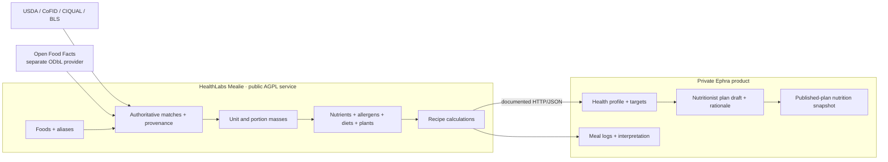

# HealthLabs ingredient nutrition service v1

Date: 2026-10-16
Status: Implemented; deployment and provider enablement pending
Owner: HealthLabsGroup

The additive schema, pinned-source import, deterministic calculations, audited
editor API, catalogue backfill, source search, and native curator UI are
implemented. The release keeps Ephra's legacy nutrition tables available only
as a one-release rollback path; it does not authorize their removal during the
initial DEV cutover.

## Decision

HealthLabs Mealie is the single source of truth for recipes, structured
ingredients, food facts, unit-to-mass conversions, and calculated recipe
nutrition. Ephra consumes those facts through the documented HealthLabs HTTP
API and does not maintain an independently editable food or nutrient catalogue.

Ephra remains the source of truth for user health profiles, personal targets,
clinical interpretation, nutritionist-authored plan drafts, private rationale,
meal logs, and the immutable nutrition snapshot stored when a plan is
published.

The upstream `recipe_nutrition` strings remain imported or author-entered
claims. They are never treated as calculated HealthLabs nutrition.

## Goals

- Give each structured Mealie food a traceable match to authoritative food
  composition data.
- Calculate ingredient and per-serving recipe nutrition deterministically.
- Keep missing or ambiguous values `null`; never invent or silently average
  values.
- Support the existing Ephra client and a future recipe-only client from the
  same service.
- Preserve the separate-service AGPL boundary: public Mealie changes, private
  Ephra health logic, HTTP/JSON integration.

## Non-goals

- Nutrient targets or clinical recommendations in Mealie.
- Automatic clinical conclusions from nutrient figures.
- Language-model-generated nutrient values, gram conversions, or source truth.
- Treating imported recipe nutrition as verified food composition data.
- Making Ephra source, credentials, health profiles, or private plan rationale
  public.

## Ownership boundary



## Authoritative data model

The HealthLabs extension adds these Mealie-owned records:

| Record | Purpose |
|---|---|
| `healthlabs_nutrient_source_releases` | Provider, version, country, licence URL, attribution text, source URL, file checksum, and import time. |
| `healthlabs_nutrient_foods` | One source food and preparation state with nullable nutrient values per 100 g edible portion. |
| `healthlabs_food_matches` | One Mealie `ingredient_foods.id` mapped to one source food, with country, method, confidence, reviewer, food group, plant, nullable allergen/diet maps, and timestamps. |
| `healthlabs_food_match_suppressions` | An editor's durable decision to leave one Mealie food unmatched so reconciliation cannot silently recreate a cleared match. |
| `healthlabs_food_portions` | Conversion from a portion or standardized unit to edible grams: source-managed rows are global, while editor-measured rows belong to one workspace. |
| `healthlabs_branded_products` | Barcode product facts kept logically separate from the generic catalogue because Open Food Facts uses ODbL. |
| `healthlabs_nutrition_work` | Group-scoped, fingerprinted ingredient, food-match, and portion work with retry and lease state. |
| `healthlabs_nutrition_curator_decisions` | Immutable, fingerprinted evidence for Apple decisions, including bounded candidates, selected IDs, confidence, reason, sanitized rationale, provider/model/prompt versions, attempts, and usage. |
| `healthlabs_food_portion_mappings` | Group-scoped accepted links from one food/unit pair to an existing authoritative portion, with agent and decision provenance. |
| `healthlabs_nutrition_provider_usage` | Deployment-wide daily provider requests, reserved/spent micro-USD, and sanitized token totals. |

`healthlabs_food_matches` is the only editable link between a Mealie food and
nutrient truth. A source re-import may update source records but must not replace
a reviewed match silently.

Source-managed portions are shared catalogue facts. Editor-measured portions
carry the matching food's group ID; reads and calculations combine source rows
only with editor rows from the current workspace. The migration assigns a legacy
editor row only when exactly one workspace already matches its source food; it
stops before schema changes when ownership is missing or ambiguous. Downgrade
also stops while editor-managed rows exist rather than discarding tenant data.

The following food facts belong to Mealie and travel with the match:

- nutrient values per 100 g;
- food group and plant identity;
- allergen status;
- vegetarian, vegan, and pescatarian status;
- preparation state and edible-portion metadata;
- source, source version, match method, confidence, and review audit.

## Source policy

Generic foods use this deterministic order:

1. A reviewed exact record from the relevant national source: CoFID for Great
   Britain, CIQUAL for France, and BLS for Germany.
2. A reviewed exact USDA FoodData Central Foundation or FNDDS record.
3. A unique exact normalized-name or curated-alias match selected and applied
   by the service, with its automatic provenance retained for later review.
4. `null` when no defensible match exists.

Polish national data is not imported until its licence is obtained and
recorded. No current Ukrainian national dataset is assumed; Ukrainian aliases
may point to an applicable open source record, with the actual source and lower
confidence visible.

Open Food Facts is used only for exact branded/barcode products. Its records and
licence metadata stay in the branded-product boundary and are not merged into
the generic source database.

Every import is repeatable from a release manifest. The manifest pins the
source version, URL, SHA-256 checksum, licence, and attribution. A changed file
under an existing version is rejected.

## Matching and review

Deterministic matching may use only a unique normalized name or curated alias
from an imported, checksummed source release. A unique result is applied with
`auto_applied=true`; it is not represented as human or agent review. Missing or
ambiguous candidates enter the bounded Curator flow instead of being guessed.

Apple is the managed nutrition-curator agent for each workspace. Apple may
select only IDs in the captured candidate set and only when confidence is at
least `0.95` with at least a `0.15` lead over the runner-up. A valid selection
is revalidated against the current fingerprint before any write. Food matches
use the same domain authorization and audit path as an editor action and become
ordinary reviewed matches: `reviewed_by_user_id` points to Apple's
`user_type=agent` identity. Ingredient structure uses a same-tenant
compare-and-set, while portion resolution writes an agent/decision-attributed
mapping to an existing authoritative portion. All three retain immutable
decision evidence. The optional sanitized first-person note is display metadata
only; it never affects the decision or write.

Explicit abstention, an empty set, a low score, a narrow margin, stale data, or
a schema-valid but inconsistent/non-supplied selection produces immutable
`insufficient_evidence` evidence and no nutrition mutation. Malformed or
schema-invalid provider output follows the provider-failure retry policy and may
end as `failed` on attempt three. Candidate snapshots, selected IDs, provider
usage, raw prompts, private recipe text, and credentials are not returned by
the public status/work APIs.

`nutrition:write` is a separate HealthLabs capability. Only a principal with
that capability may accept, replace, or clear a food match or edit manually
curated safety metadata. Every write records the actor and reason in the
immutable HealthLabs audit log.

Ordinary users can read calculated nutrition for visible recipes but cannot
change source matches. Catalogue editors and meal-plan editors do not receive
`nutrition:write` implicitly.

## Calculation contract

For every ingredient, Mealie resolves edible grams before calculating figures:

```text
ingredient nutrient = edible grams * source value per 100 g / 100
recipe nutrient     = sum of complete ingredient nutrient values
per-serving value   = recipe nutrient / recipe servings
```

Mass units convert directly. Volume, piece, spoon, slice, and other portions
require a source-backed food-specific conversion. When a match, conversion,
serving count, or nutrient is missing, the affected result is `null` and the
response reports why it is incomplete. Zero is returned only when the source
explicitly reports zero.

One recipe response exposes:

- each ingredient's resolved grams and food facts;
- recipe totals and per-serving figures;
- `complete`, `missingIngredientReferences`, and `sourceVersions`;
- current calculated facts separately from upstream claimed nutrition.

Calculations use decimal arithmetic and round only the public result. Recipes
with zero servings may expose totals but not per-serving figures.

## HTTP contract

The existing `/api/healthlabs/v1/recipes` representation gains nullable
calculated nutrition on foods, ingredients, and recipes. Existing fields and
write payloads remain compatible.

HealthLabs adds:

```text
GET /api/healthlabs/v1/nutrition/foods?q=&country=&status=
GET /api/healthlabs/v1/nutrition/foods/{food_id}
GET /api/healthlabs/v1/nutrition/source-foods?q=&country=&limit=
PUT /api/healthlabs/v1/nutrition/foods/{food_id}/match
DELETE /api/healthlabs/v1/nutrition/foods/{food_id}/match
POST /api/healthlabs/v1/nutrition/foods/{food_id}/portions
GET /api/healthlabs/v1/nutrition/sources
GET /api/healthlabs/v1/nutrition/worker-status
GET /api/healthlabs/v1/nutrition/work?state=review_required&kind=&limit=50
GET /api/healthlabs/v1/capabilities
```

Write routes require `nutrition:write`, an idempotency key, and an access
reason. Reads obey existing recipe visibility and tenant boundaries. Provider
IDs, source IDs, and provenance may be returned; credentials and unrelated
workspace data may not.

## Native curator UI

Editors with an active `nutrition:write` grant can open `/nutrition` in Mealie.
The navigation link and route use the authenticated capability endpoint; the
existing backend checks remain authoritative for every write.

The page reads the current workspace's foods and imported source records from
the running database. It does not use fixtures or mock nutrition data. An
editor can filter the queue, search a selected country's source records,
approve or replace a match, clear a match, and add a positive measured portion.
Measured portions are visible and used in calculations only inside the workspace
that created them.
Nullable source values stay unavailable in the UI, while source-reported zero
remains visible as zero. All mutations use idempotency keys and fixed,
operation-specific audit reasons.

Source-food search is available to authenticated users because it returns only
public licensed catalogue facts. It matches every normalized query token,
returns only the requested country plus country-neutral `OTHER` records, and
never creates or approves a match. Editors pass a selected source-food ID to
the existing audited match route.

The page also shows sanitized Apple state and notes plus `Reviewed by Apple —
Nutrition Curator` with an `agent` badge. Existing source and measured-portion
controls remain available as audited human break-glass controls while Apple is
pending, running, abstained, or failed. The page is not required for autonomous
operation and exposes no retry/delete operation for immutable decisions.

## Background reconciliation

Mealie's existing scheduler runs reconciliation every five minutes. A tick
repeats 20-target batches until the queue is idle or its four-minute wall-time
limit is reached. It claims due work with a 15-minute lease and commits each
target independently. A concurrent in-process tick exits immediately; after a
restart, an expired lease is reclaimable.

The persisted states are `pending`, `running`, `review_required`, `completed`,
and `failed`. Provider errors retry after 5 and 30 minutes, then stop after the
third failed attempt. Changed source text, catalogue data, provider
configuration, reviewed match, source release, or portion data changes the
relevant fingerprint and makes the target eligible again. Unchanged review
work is not retried and does not spend another provider request.

Before calling the provider, Apple may reuse an approved decision from the
same workspace only when the work input, candidate snapshot, catalogue and
source releases, provider/model, and persona/prompt/policy context are
identical. Reuse creates a separate immutable decision for the target, links
it to the source decision, records no provider usage, and passes through the
same current-fingerprint, candidate, confidence, margin, and compare-and-set
validation as a new response. Conflicting approved decisions abstain with
`reuse_conflict`; legacy decisions without a reuse fingerprint never seed
reuse.

Deterministic reconciliation always remains in the Mealie process:

1. Resolve free-text ingredients against unique exact group food/unit records.
2. Apply a unique exact normalized-name or curated-alias source match with
   `auto_applied=true`.
3. Resolve grams only from mass units or authoritative source/editor portions.
4. Leave ambiguous or missing ingredient, food, and portion work in
   `review_required` for Apple or a human break-glass editor.

Apple runs as a second process from the same application image, database, and
configuration:

```sh
mealie-nutrition-curator
```

Set that executable as the worker container command and disable the image's
HTTP healthcheck for the worker; the inherited healthcheck targets the API,
which this process intentionally does not start.

`HEALTHLABS_NUTRITION_CURATOR_ENABLED=false` and
`HEALTHLABS_NUTRITION_CURATOR_POLL_SECONDS=30` are the defaults. When disabled,
the process exits successfully and deterministic reconciliation is unchanged.
When enabled, deploy exactly one Curator process initially. It evaluates at
most one due decision per iteration, then immediately checks for more work; it
waits for the poll interval only while idle. Add replicas only after observing
lease and budget behavior under production load.

Paid work is possible only when all of these prerequisites are present:

- `HEALTHLABS_NUTRITION_CURATOR_ENABLED=true`;
- the group has a valid default provider and model;
- `HEALTHLABS_NUTRITION_PROVIDER_DAILY_REQUEST_LIMIT` is positive;
- `HEALTHLABS_NUTRITION_PROVIDER_DAILY_BUDGET_USD` is positive; and
- at least one input/output USD-per-million-token rate is positive.

`HEALTHLABS_NUTRITION_PROVIDER_MAX_OUTPUT_TOKENS` defaults to `256`. The regular
reconciliation parser and Apple share the deployment-wide daily request/USD
budget. Before network I/O, each call atomically reserves its worst-case token
cost; returned usage settles only that reservation. Missing usage or a crash
leaves the reservation charged for the UTC day. Provider credentials stay in
runtime provider settings and never enter the image, repository, evidence,
public responses, or logs.

Apple claims work with a 15-minute lease and a provider timeout that leaves one
minute to finalize. Provider failures retry after 5 and 30 minutes. The third
failed attempt is terminal for that complete fingerprint; it is eligible again
only when target, candidates, catalogue/source, provider/model, prompt/policy,
or persona input changes and creates a new fingerprint. `insufficient_evidence`
is also terminal for an unchanged fingerprint. Expired running leases are
reclaimable; accepted writes are compare-and-set and idempotent across restart
or competing workers.

SIGTERM or SIGINT stops new claims and interrupts idle waiting immediately. A
signal received during a bounded provider call lets that call finalize or fail,
then exits before another claim. Decision evidence remains durable across the
restart.

Apple uses identity/persona version
`healthlabs-nutrition-curator-apple-v1`, prompt version
`healthlabs-nutrition-curator-v1`, and policy version
`healthlabs-nutrition-curator-policy-v1`. Before enabling any new prompt/model
pair, an operator must run the representative live golden set twice—once with
Apple and once with the policy-only control—and confirm identical validated
selections/abstentions and zero invalid writes. Recorded offline fixtures guard
the same boundary in automated tests; the live comparison is an external
pre-enable operation and is not performed by this branch.

`nutrition:write` editors see work counts, five-state `curatorCounts`,
`lastUpdatedAt`, and `curatorLastUpdatedAt` through `worker-status`; `/work`
returns only the latest decision for the current work-input fingerprint: state,
reason, attempt count, Apple note, and agent display identity. Process logs
contain aggregate claimed/approved/abstained/failed counts. Monitor a growing
curator `failed` count, repeated budget exhaustion, or leases that stay
`running` past expiry.

Rollback is disable-first: set `HEALTHLABS_NUTRITION_CURATOR_ENABLED=false`
and restart the Curator process before reverting API/UI code. Setting the shared
request limit or USD budget to `0` also prevents paid calls, but disabling the
Curator is the unambiguous stop control. Retain decision/work tables as audit
evidence. Already accepted matches remain valid ordinary reviewed matches tied
to the Apple agent; rollback does not delete them. Retain portion mappings while
any production calculation depends on them. The paired downgrade refuses while
agent users, decision evidence, or portion mappings remain; remove mappings only
after replacing/reviewing their conversions and proving no production
calculation depends on them.

## Ephra consumption and snapshots

Ephra ownership cutover is a separate downstream project. This Mealie branch
does not switch Ephra reads, remove Ephra writers, or migrate/delete Ephra data.

Ephra removes its food catalogue and enrichment code only after the Mealie
catalogue is populated, all current Mealie foods are matched or explicitly
unknown, and the new provider response has run in shadow mode.

Ephra may retain:

- a short-lived response cache;
- nutrient values copied into a saved meal log as an event-time fact;
- an immutable nutrient and safety snapshot when a nutritionist publishes a
  plan;
- source IDs and versions needed to explain those snapshots.

Those copies are not editable catalogues and never become a competing source of
truth. Existing Ephra enrichment tables remain read-only for one rollback
release, then are removed in a later migration.

## Migration and rollback

The following sequence describes that later Ephra project; it is not authorized
or executed by the nutrition-curator rollout:

1. Deploy the additive Mealie schema and APIs without changing Ephra reads.
2. Import pinned food-source releases and match current Mealie foods.
3. Compare Mealie results with existing Ephra enrichment and record differences
   without changing user responses.
4. Switch recipe and food normalization reads to Mealie; preserve saved meal and
   published-plan snapshots.
5. After one verified release, remove the old Ephra catalogue and enrichment
   writers, then remove their tables in a separate reversible migration.

Rollback before step 5 switches the Ephra feature flag back to the read-only
legacy data. Rollback after table removal restores the paired Ephra and Mealie
database backup created immediately before the migration.

## Acceptance criteria

- Mealie is the only editable owner of food matches, food facts, conversions,
  and recipe nutrition.
- All source-derived values include provider, source food ID, version, licence,
  and checksum provenance.
- The target DEV workspace has every structured food classified as
  matched, review-required, or unknown; unparsed ingredient lines stay explicit
  and no fabricated values exist.
- Recipe totals are deterministic and missing data remains `null`.
- `nutrition:write` is independently grantable, revocable, and audited.
- Ephra consumes the documented API and stores only event/publication snapshots
  plus temporary caches.
- Existing personal recipe ownership, catalogue immutability, meal-plan editor
  permissions, and AGPL service separation continue to pass their tests.
